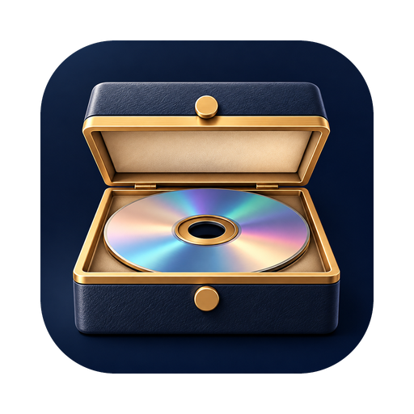
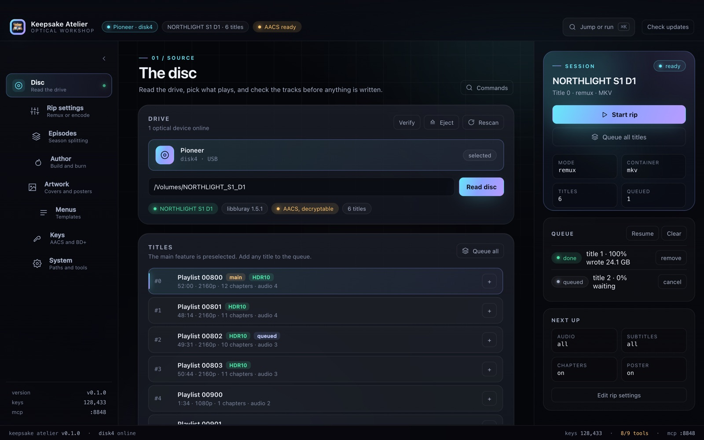

<p align="center">
  
</p>

<h1 align="center">Keepsake Atelier</h1>

<p align="center">
  <b>Blu-ray ripping, authoring, menus and burning.</b><br>
  Native AACS keys. UDF 2.50 images. Authored BD-J menus. No MakeMKV, no subscription.
</p>

<p align="center">
  <a href="https://discord.gg/SUaUrVGj5f"></a>
  <a href="https://ko-fi.com/ghosty99"></a>
  <a href="https://etherscan.io/address/0xbBef115aD853236a350EaF04777a2AdB2e7c0317"></a>
  <a href="https://ghostyshell.github.io/keepsake-atelier/"></a>
  <a href="LICENSE"></a>
</p>

Keepsake Atelier is a desktop workshop for the discs you already own. It reads
what is on a Blu-ray or DVD, takes it apart without re-encoding when you do not
want to, puts a new disc together when you do, and checks the result before it
reaches a writer.

It uses native tooling wherever possible: libbluray for navigation, libaacs for
decryption, `newfs_udf` and `hdiutil` for UDF 2.50 images and burns on macOS,
and a bundled ffmpeg for muxing and encoding. The app runs on macOS, Linux and
Windows from one Rust engine.

- **Site:** https://ghostyshell.github.io/keepsake-atelier/
- **Guides:** [docs/guides/index.md](docs/guides/index.md)
- **Features:** [docs/features.md](docs/features.md)
- **Roadmap:** [docs/roadmap.md](docs/roadmap.md)

<p align="center">
  
</p>

## Download

<!-- downloads:start -->
| Build | GoFile (primary) | file.kiwi (backup) | Size |
| --- | --- | --- | --- |
| `Keepsake-Atelier-0.1.0-arm64.dmg` | [Download](https://gofile.io/d/W9bGQWqj) | [Mirror](https://file.kiwi/64b07650#KzpjVFGnGJFmSkn08xvjng) | 34.5 MiB |
| `Keepsake-Atelier-0.1.0-x64.dmg` | [Download](https://gofile.io/d/xRGaBKub) | [Mirror](https://file.kiwi/753ddc20#m51mRozH0-pYNRmCQtJ--g) | 38.9 MiB |
| `keepsake-atelier-0.1.0-macos-arm64.tar.gz` | [Download](https://gofile.io/d/2wvXYckY) | [Mirror](https://file.kiwi/3ba97c4d#q10Vi_Q5bzWJa7uMOEGzBA) | 2.3 MiB |
| `keepsake-atelier-0.1.0-macos-x64.tar.gz` | [Download](https://gofile.io/d/I5W2kjPw) | [Mirror](https://file.kiwi/ecbc8516#JzA0rtWZxPvQZxx9d_f4-Q) | 2.4 MiB |
| `keepsake-atelier-0.1.0-linux-x64.tar.gz` | [Download](https://gofile.io/d/aJ6v2Opm) | [Mirror](https://file.kiwi/b3b12b66#mVolYeulDn1io3L22RYmEA) | 2.4 MiB |
| `Keepsake-Atelier-0.1.0-linux-x64.AppImage` | [Download](https://gofile.io/d/s2335WNP) | [Mirror](https://file.kiwi/f45a624b#T7PmO4_Tf6wa4mnhcabo1A) | 144.3 MiB |
| `Keepsake-Atelier-0.1.0-linux-x64.deb` | [Download](https://gofile.io/d/V4BMQLNB) | [Mirror](https://file.kiwi/c8718370#5gIk3UoLczfKYPEMUVbUTA) | 6.5 MiB |
| `keepsake-atelier-0.1.0-windows-x64.zip` | [Download](https://gofile.io/d/SJIj6LDp) | [Mirror](https://file.kiwi/ee4a4d85#AGHABZ448Y4y4XVJ5iMfNQ) | 8.4 MiB |
| `Keepsake-Atelier-0.1.0-windows-x64-setup.exe` | [Download](https://gofile.io/d/MjssrRzq) | [Mirror](https://file.kiwi/4cd81a91#TimFMBj5JislRUCFK-PcqA) | 99.2 MiB |
<!-- downloads:end -->

Apple Silicon or Intel on macOS 15 or newer, plus Linux x86_64 and Windows
x86_64 builds. The links are refreshed weekly because GoFile expires free-tier
files. The [project site](https://ghostyshell.github.io/keepsake-atelier/#downloads)
reads the same manifest.

The DMG is self-contained: libbluray, libaacs, libbdplus and their dependencies
are inside the bundle. The CLI tarballs are not; they need the Homebrew
libraries. The app is not notarized. On first launch, right-click the app,
choose **Open**, then confirm. Or clear the quarantine flag:

```sh
xattr -dr com.apple.quarantine "/Applications/Keepsake Atelier.app"
```

The tarball is the CLI only. Unpack it and put `keepsake-atelier` on your
`PATH` if you want the command line without the app. Linux also ships an
AppImage and a deb; Windows ships a CLI zip and an NSIS installer. Both desktop
builds are previews, and the macOS DMG is the reference app. See
[docs/platforms.md](docs/platforms.md) for what works on each platform.

## Support

The app is MIT and stays free. There is no paid tier.

- **Discord:** https://discord.gg/SUaUrVGj5f
- **Ko-fi:** https://ko-fi.com/ghosty99
- **Ethereum:** `0xbBef115aD853236a350EaF04777a2AdB2e7c0317` ([Etherscan](https://etherscan.io/address/0xbBef115aD853236a350EaF04777a2AdB2e7c0317))

## Quick start

```sh
keepsake-atelier doctor                     # what is installed and connected
keepsake-atelier devices                    # optical drives
keepsake-atelier disc /Volumes/MY_DISC      # titles, playlists, streams
keepsake-atelier rip /Volumes/MY_DISC       # main title, lossless remux
keepsake-atelier verify /Volumes/MY_DISC    # navigation and clip check
```

Authoring:

```sh
keepsake-atelier author movie.mkv --out movie.iso --label MY_MOVIE
keepsake-atelier author ep1.mkv ep2.mkv --out season.iso --menu
```

Burning is opt-in:

```sh
keepsake-atelier burn movie.iso             # dry run, prints the command
keepsake-atelier burn movie.iso --yes       # writes the disc
```

The app exposes the same workflow as cards: discs, titles, rips, authoring,
menus, keys, DVD, covers, queue, verify, burn and system check.

## What it does

- **Inspect.** Title map, playlists, clips, durations, chapters, streams, HDR,
  AACS state, and the navigation table from `index.bdmv`.
- **Keys.** Native AACS1 recovery from the drive's volume ID and the disc's MKB
  on macOS, Linux and Windows, plus AACS2 unit keys derived offline from
  `Unit_Key_RO.inf`. KEYDB import, search and edit. MakeMKV dumps are a
  fallback, not a requirement.
- **Rip.** Lossless remux to MKV or MP4, or x264, x265 and VideoToolbox encode.
  English non-commentary audio by default, subtitles off, chapters and metadata
  kept.
- **Author.** One title or many, a BDMV folder or a native UDF 2.50 ISO, chapter
  marks from the inputs, optional BD-J title menu, and BD-25/BD-50 splitting.
- **Menus.** A real 1080p BD-J menu with one row per title, a background,
  arrows, digits and mouse. One generic Xlet reads the disc's own `menu.txt`.
  Menu documents can be parsed, edited, saved and applied to another disc.
- **DVD.** List and rip `VIDEO_TS` titles through ffmpeg's `dvdvideo` demuxer.
- **TV.** Split a disc into per-episode files with SxxExx names, OP/ED detection
  and TMDB metadata.
- **Copy.** 1:1 encrypted clone, decrypted ISO, or a plain folder.
- **Verify.** Walk every title, movie object, playlist, clip and menu row before
  you burn.
- **Burn.** Native `hdiutil burn` on macOS, growisofs on Linux, and Windows'
  IMAPI2 stack. Dry run by default. Confirmation required.
- **Automate.** Every capability is a CLI command and an MCP tool. The server is
  off by default and binds to loopback.

The complete list, including limits and caveats, is in
[docs/features.md](docs/features.md).

## Guides

| Guide | What it covers |
| --- | --- |
| [Install](docs/guides/install.md) | Download, Gatekeeper, first launch, drive check |
| [Rip a movie](docs/guides/rip.md) | Pick a title, choose tracks, remux or encode |
| [Author a disc](docs/guides/author.md) | One or many titles, folders and ISOs, splitting |
| [Menus](docs/guides/menus.md) | BD-J title menu, background, templates, checks |
| [Keys and AACS](docs/guides/keys.md) | KEYDB, native recovery, AACS2, LibreDrive |
| [DVD-Video](docs/guides/dvd.md) | List and rip DVD titles |
| [TV and anime](docs/guides/tv.md) | Episode split, naming, openings and endings |
| [Burn and verify](docs/guides/burn.md) | Size query, dry run, write, read back |
| [MCP](docs/guides/mcp.md) | Drive the app from Claude, Cursor or a script |
| [Troubleshooting](docs/guides/troubleshooting.md) | The errors people actually hit |

## Build from source

Prerequisites on macOS:

- Xcode command line tools, Rust and Node.
- Homebrew libraries: `libbluray libaacs libbdplus`.
- The bundled ffmpeg is built once with `scripts/build-ffmpeg.sh`.

```sh
cargo build --release
./target/release/keepsake-atelier doctor

cd app
npm install
npm run tauri dev       # development
npm run tauri build     # app and DMG
```

`BLURAY_PREFIX` overrides the libbluray prefix. `KEEPSAKE_FFMPEG` points at a
specific ffmpeg. The pre-rename `BLUFORGE_*` environment names are still
accepted.

## Architecture

```
core/           keepsake-core - framework-agnostic engine (Rust)
  device.rs       IOKit device enumeration, optical detection
  keys.rs         KEYDB.cfg store, search, validation
  native.rs       native AACS1/AACS2 key recovery
  disc.rs         libbluray FFI (titles, decrypted title streaming)
  bluray_shim.c   small C shim so Rust avoids libbluray struct layout churn
  menu.rs         menu documents: index.bdmv navigation + editable templates
  bdjo.rs         BD-J object writer for authored title menus
  assets/menu/    the generic menu Xlet (00000.jar) and its source
  bdmv.rs         multi-title index/MovieObject writer, menu install
  udf.rs          native UDF 2.50 images with newfs_udf and hdiutil
  udf_portable.rs portable UDF 2.50 images (hadris-cd) for Linux and Windows
  burn.rs         hdiutil burn / growisofs orchestration
  rip.rs          ffmpeg orchestration (remux / encode) with progress
  dvd.rs          DVD-Video title parse and rip
  iso.rs          decrypted ISO and folder export
  verify.rs       navigation, playlist, clip and menu checks
  config.rs       persisted settings
cli/            `keepsake-atelier` - headless CLI
app/            Tauri v2 desktop app (React + TypeScript frontend)
  src-tauri/      Rust commands bridging the UI to core
docs/           guides, feature list, publishing and the project site
scripts/        ffmpeg build, menu asset, release publishing, weekly refresh
```

Decryption is Rust orchestration over libbluray plus an AACS backend. libaacs
with the local KEYDB is the default. MakeMKV's `libmmbd` is used only as a
fallback for a disc that cannot be keyed natively, or for BD+ without VM data.
ffmpeg is used only for muxing and encoding, never decryption.

## Publishing

Releases are published to GoFile and mirrored to file.kiwi. A launchd job
rebuilds the current version, re-uploads the artifacts, repoints
`docs/downloads.json` and the README table, commits the change and cleans up the
local build. See [docs/publishing.md](docs/publishing.md).

```sh
scripts/publish-release.sh          # build, upload, patch links, push
scripts/refresh-release-links.sh    # what the weekly job runs
scripts/install-refresh-job.sh      # install the launchd agent
```

## Testing without a drive

`scripts/mkbd.mjs` builds a small but spec-valid BDMV tree (index, MovieObject,
playlist, clip and an ffmpeg-made H.264 + AC-3 clip), so the whole pipeline runs
with no hardware:

```sh
node scripts/mkbd.mjs /tmp/testbd 8
./target/release/keepsake-atelier disc /tmp/testbd
./target/release/keepsake-atelier rip  /tmp/testbd /tmp/out.mkv --title 0
./target/release/keepsake-atelier iso  /tmp/testbd /tmp/out.iso --label SINTEL
```

The test suite runs with `cargo test`.

## Documentation

- [Features](docs/features.md) - the complete capability list.
- [Guides](docs/guides/index.md) - task-shaped pages.
- [Publishing](docs/publishing.md) - builds, mirrors, weekly refresh.
- [Menu templates](docs/menu-templates.md) - the menu-document format.
- [Decryption](docs/decryption.md) - AACS, BD+ and the backends.
- [ffmpeg](docs/ffmpeg.md) - how the bundled build is made.
- [Platforms](docs/platforms.md) - what works on macOS, Linux and Windows.
- [Roadmap](docs/roadmap.md) - phases and known limits.
- [Interface design](DESIGN.md) - direction, tokens, motion and accessibility.
- [Design skills](docs/design-skills.md) - the skill routing used for the UI.
- [Site source](docs/site/README.md) - the GitHub Pages landing page.
- [Contributing](CONTRIBUTING.md) - build, tests, style and the release process.

## Notes and limits

- macOS first. The macOS app is the reference build. Linux ships a tested CLI
  plus AppImage and deb previews; Windows ships a CLI zip and an NSIS installer
  preview. See [docs/platforms.md](docs/platforms.md) for the per-platform
  matrix.
- Cinavia is a proprietary audio watermark. There is no open detector or
  remover, and none is bundled.
- Authored BD-J menus are verified in a JVM harness and by libbluray's parser,
  not on a hardware player. They are opt-in.
- Burning needs a writer and a blank BD-RE or BD-R. The drive and size query are
  tested; a physical write is still worth doing on your own media.
- Native key recovery needs a LibreDrive vendor read. Stock firmware on some
  drives does not provide it. libaacs with a KEYDB entry still decrypts.

## License

MIT. See [LICENSE](LICENSE).
